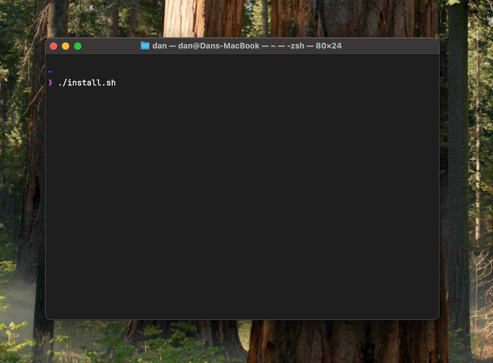

# Dotfiles

## What's included

- [Homebrew](https://brew.sh/)
- Ruby, Node.js LTS, and Python managed by [mise](https://github.com/jdx/mise)
- Gems for development: Ruby on Rails, Bundler, RuboCop, Ruby LSP, etc.
- Zsh with [Oh My Zsh](https://github.com/ohmyzsh/ohmyzsh)
- Zed settings and automatic installation of extensions from `zed/settings.json`
- Common development dependencies: PostgreSQL, ImageMagick, ssh-copy-id
- Apps: 1Password, Figma, Firefox, GitUp, Google Chrome, IINA, Rectangle, SF Symbols, Spotify, Transmission, Zed, and many other (customize in `Brewfile`)
- Homebrew Fonts: Fira Mono, Inter, Noto (Mono, Sans, Serif), etc. (customize in `Brewfile`)
- SSH key restoration from Passwords (ed25519)

## Screenshot



## Install

Language versions are configured in `mise.toml`. The installer links it to
`~/.config/mise/config.toml` and runs `mise install` to install the configured tools.

```bash
# Install Xcode tools
xcode-select --install

# Clone dotfiles repo and change directory
git clone https://github.com/dankimio/dotfiles.git ~/Developer/dotfiles
cd ~/Developer/dotfiles

# Install using the script
./install.sh
```

If `~/.ssh/id_ed25519` is missing, setup prompts you to paste your full OpenSSH
private key from Passwords and press Enter. Input is hidden. The key must have no
passphrase; setup validates it and recreates the public key before saving either
file. Existing private keys are kept.

You can also restore the key separately:

```bash
bash restore-ssh-key.sh
```
